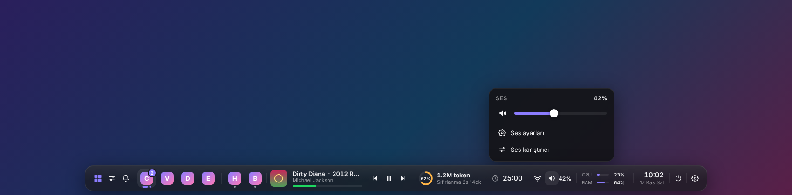
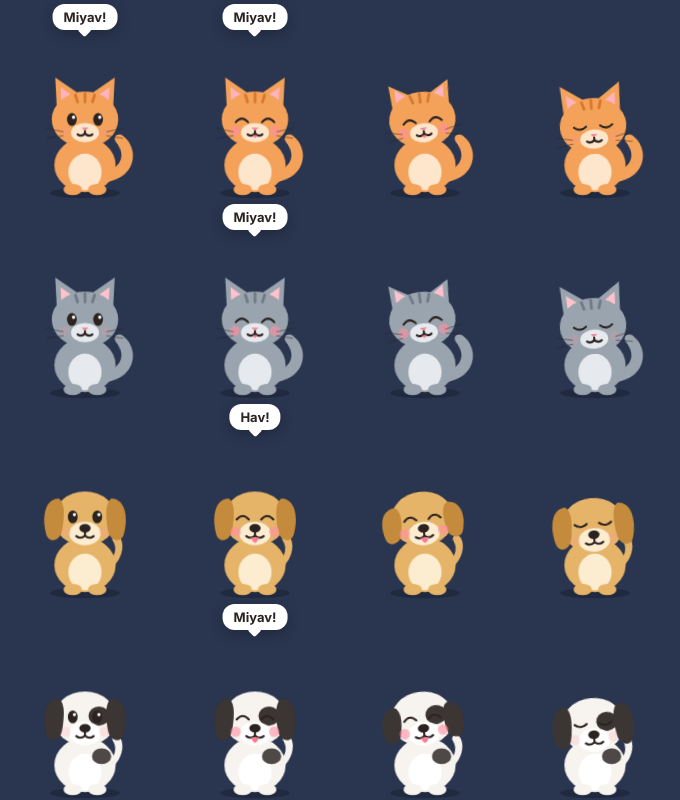
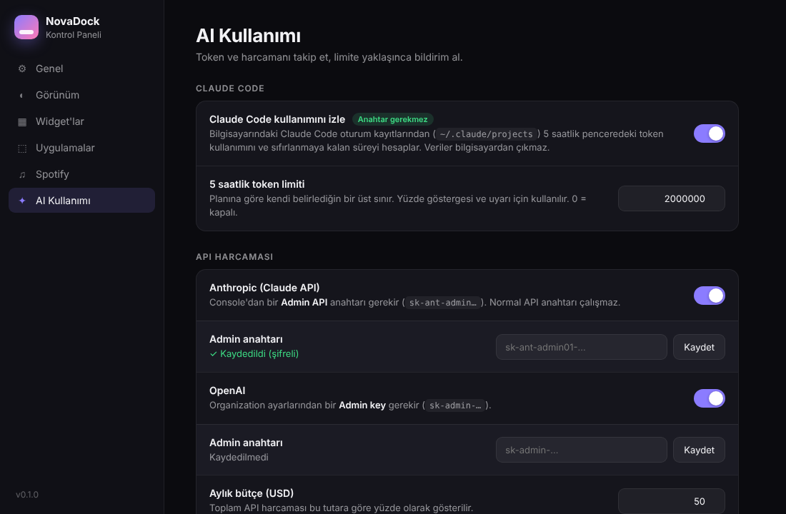

# NovaDock

Windows 10/11 için akıllı dock. Görev çubuğunun yerine geçer; açık pencereler, Spotify, AI kullanımı, sistem durumu ve daha fazlası tek bir şık çubukta.



## Özellikler

- **Uygulamalar ve açık pencereler:** Sabitlenmiş uygulamalar ve çalışan pencereler görev çubuğundaki gibi görünür. Tıklayınca pencere öne gelir, tekrar tıklayınca küçülür. Microsoft Store uygulamalarının simgeleri de desteklenir.
- **Sağ tık menüsü:** Uygulamayla açılan son dosyalar, "Yeni pencere" / "Yeni gizli pencere" gibi görevler, sabitleme ve pencereleri kapatma.
- **Pencere önizlemesi:** Simgenin üstüne gelince açık pencerelerin küçük görüntüleri çıkar. Pencere sayısı rozetle gösterilir, önizlemeden pencere kapatılabilir.
- **Evcil hayvan:** Masaüstünde yaşayan bir kedi ya da köpek. Sürükleyip istediğin yere taşıyabilirsin. Tıklayınca zıplar, basılı tutunca sevilmiş gibi mırlar, fareni gözleriyle takip eder ve uzun süre dokunmazsan uyur.
- **Spotify / müzik:** Albüm kapağı, şarkı, sanatçı ve ilerleme çubuğu Windows'un medya altyapısından okunur. Spotify Free'de de çalışır, API anahtarı gerekmez.
- **AI kullanımı:**
  - Claude Code'un 5 saatlik token penceresini ve sıfırlanmaya kalan süreyi gösterir. Bunun için anahtar gerekmez, bilgisayardaki kayıtlardan okunur.
  - İsteğe bağlı olarak Anthropic ve OpenAI API'lerinin aylık harcamasını gösterir (Admin anahtarı gerekir).
  - Limite yaklaşınca Windows bildirimi gönderir.
- **Odak zamanlayıcı:** Pomodoro; süre bitince bildirim gelir.
- **Sistem:** CPU, RAM ve pil.
- **Saat ve takvim**
- **Güç menüsü:** Kilitle, uyku, oturumu kapat, yeniden başlat, kapat.
- **Başlat ve hızlı ayarlar:** Başlat menüsü, Windows hızlı ayarlar (Wi-Fi, Bluetooth, parlaklık) ve bildirim paneli düğmeleri.
- **Wi-Fi ve ses:** Bağlı ağın adı ve sinyal gücü, ses seviyesi çubuğu, sessize alma. Fare tekerleğiyle ses ayarlanabilir.
- **Kontrol paneli:** 4 stil (Glass, Midnight, White, Black), hap ya da tam genişlik şekli, üst ya da alt konum, widget'ları açma/kapama ve sıralama.
- **Windows ile uyum:** Dock, görev çubuğu gibi ekranda yer ayırır. Windows görev çubuğunu otomatik gizler, çıkınca eski haline getirir. Tam ekran oyun ve videolarda kendini gizler.





## Kurulum

### Hazır kurulum dosyası
[Releases](../../releases) sayfasından `NovaDock Setup x.y.z.exe` dosyasını indirip kur. Windows "Bilgisayarınız korundu" uyarısı gösterirse **Ek bilgi → Yine de çalıştır** de. Bu uyarı, uygulama dijital olarak imzalanmadığı için çıkar.

### Kaynak koddan

[Node.js](https://nodejs.org) LTS gerekir.

```
git clone https://github.com/YahyaOrcun/novadock
cd novadock
npm install
npm start
```

Kurulum dosyası oluşturmak için **yönetici olarak açılmış** bir komut penceresinde (ya da Windows Geliştirici Modu açıkken) şunu çalıştır:

```
npm run dist
```

Çıktı `dist/` klasörüne yazılır.

<details>
<summary>"Electron failed to install correctly" hatası</summary>

Bazı Node/npm sürümlerinde Electron'un indirme adımı sessizce atlanabiliyor. Proje klasöründe şu komutu çalıştır:

```
powershell -NoProfile -Command "$ProgressPreference='SilentlyContinue'; $v=(Get-Content node_modules\electron\package.json | ConvertFrom-Json).version; Invoke-WebRequest -UseBasicParsing ('https://github.com/electron/electron/releases/download/v' + $v + '/electron-v' + $v + '-win32-x64.zip') -OutFile electron.zip; Expand-Archive electron.zip node_modules\electron\dist -Force; Set-Content node_modules\electron\path.txt 'electron.exe' -NoNewline; Remove-Item electron.zip"
```
</details>

## Kullanım

- **Kontrol paneli:** Dock'taki ⚙ düğmesi ya da sistem tepsisindeki simge.
- **Çıkış:** ⚙ düğmesine sağ tık → "NovaDock'tan çık".
- **Zamanlayıcı:** Tıkla başlat/duraklat, sağ tıkla süre seç.

## Gizlilik

Hesap, sunucu ya da telemetri yok. API anahtarları Windows DPAPI ile şifrelenip sadece bilgisayarında saklanır ve yalnızca ilgili sağlayıcıya (Anthropic, OpenAI, Spotify) gönderilir.

## Proje yapısı

```
src/
  main.js            Ana süreç: pencereler, tray, IPC, uyarılar
  win32.js           Windows API (koffi): AppBar, görev çubuğu, pencereler, simgeler, medya tuşları
  store.js           Ayarlar + şifreli anahtar deposu
  preload.js         Arayüzle güvenli köprü
  services/
    media.js         Windows medya oturumu (albüm kapağı, ilerleme)
    audio.js         Sistem ses seviyesi (Core Audio)
    network.js       Wi-Fi / Ethernet durumu
    jumplist.js      Sağ tık menüsü: son dosyalar, görevler
    spotify.js       Spotify: medya oturumu, pencere başlığı, isteğe bağlı Web API
    ai.js            Claude Code kayıtları, Anthropic/OpenAI maliyet API'leri
    system.js        CPU/RAM
  dock/              Dock arayüzü
  settings/          Kontrol paneli
```

### Yeni widget eklemek

1. `src/dock/dock.js` içinde `widgets.yeniWidget = { mount(el) { ... } }` tanımla.
2. `src/store.js` içindeki `DEFAULTS.widgets` listesine `{ id: 'yeniWidget', enabled: true }` ekle.
3. `src/settings/settings.js` içindeki `WIDGET_META` nesnesine adını ve açıklamasını yaz.

## Lisans

MIT
